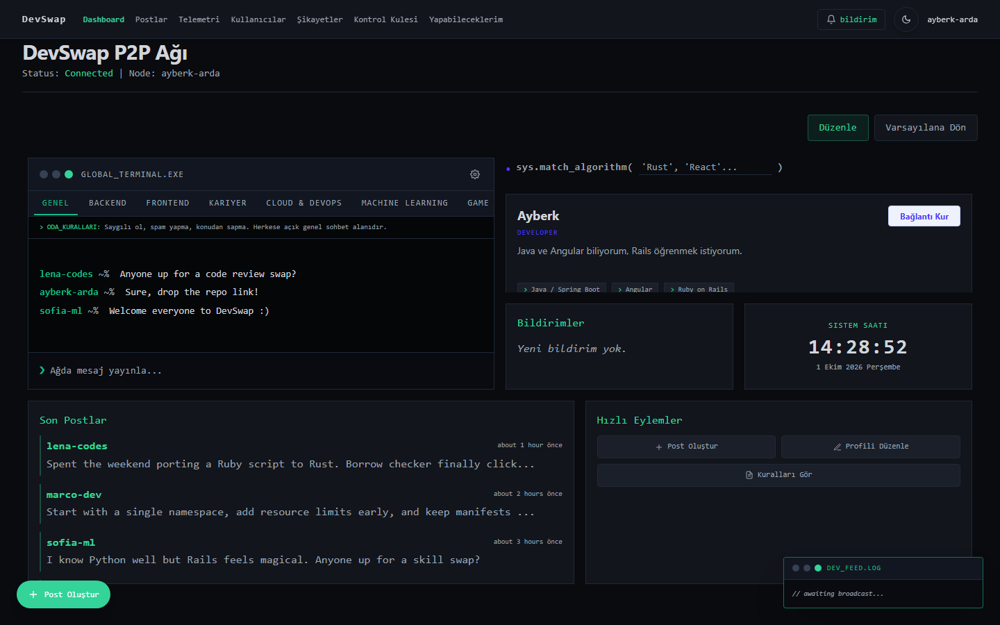
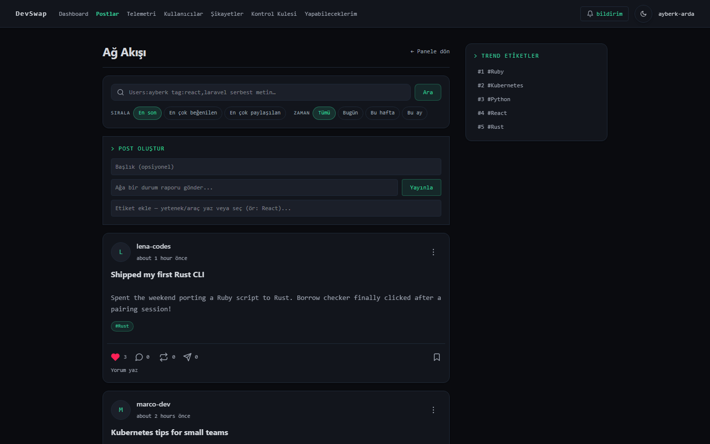
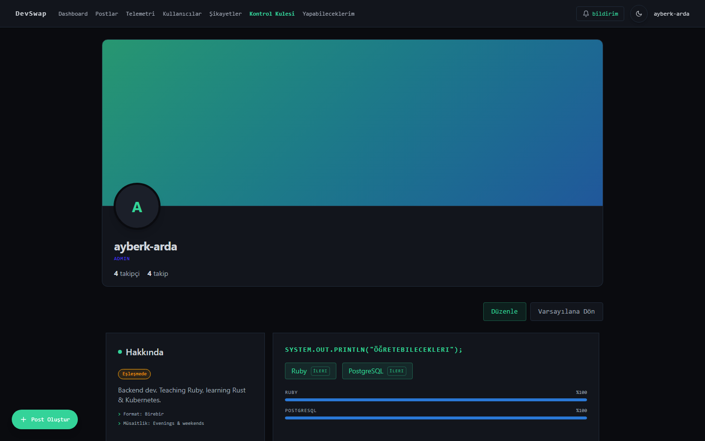
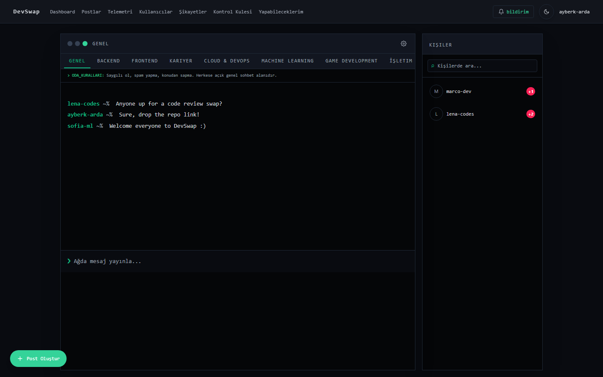
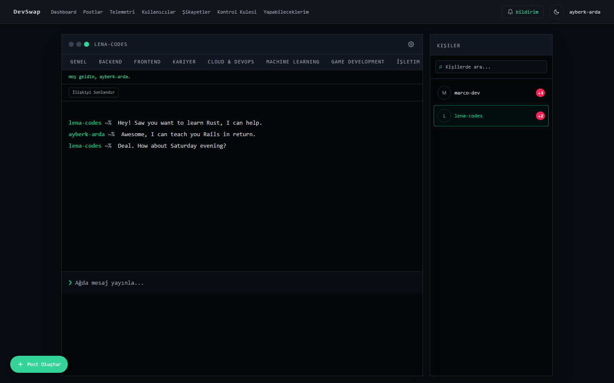
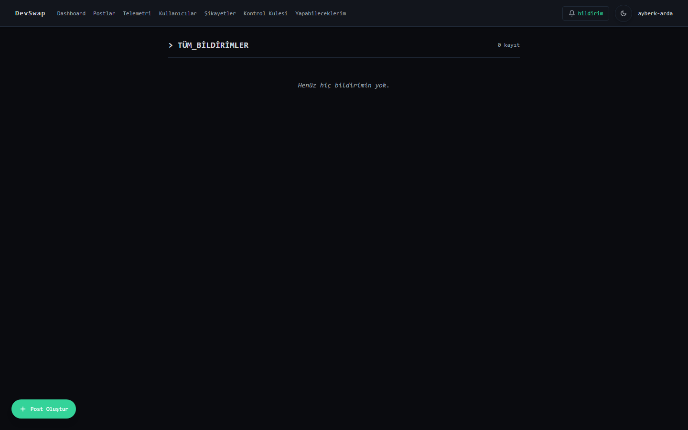
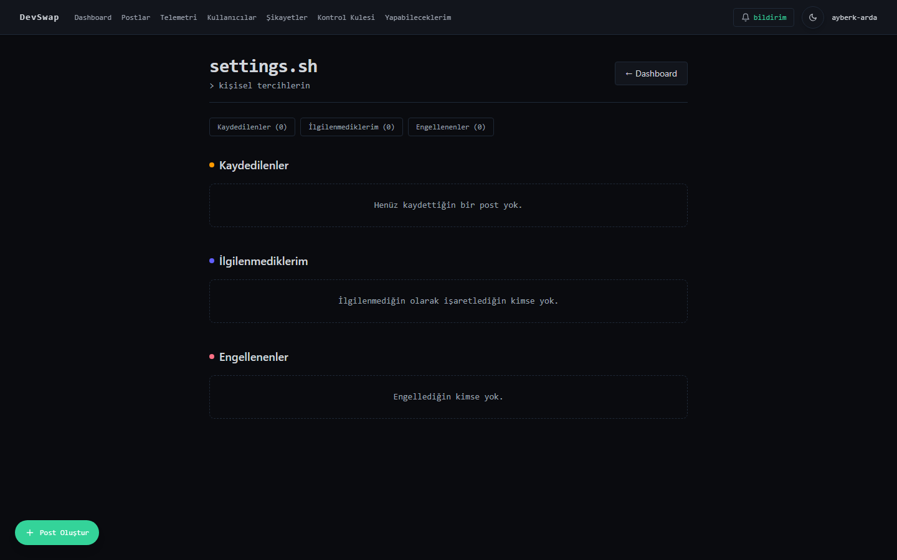
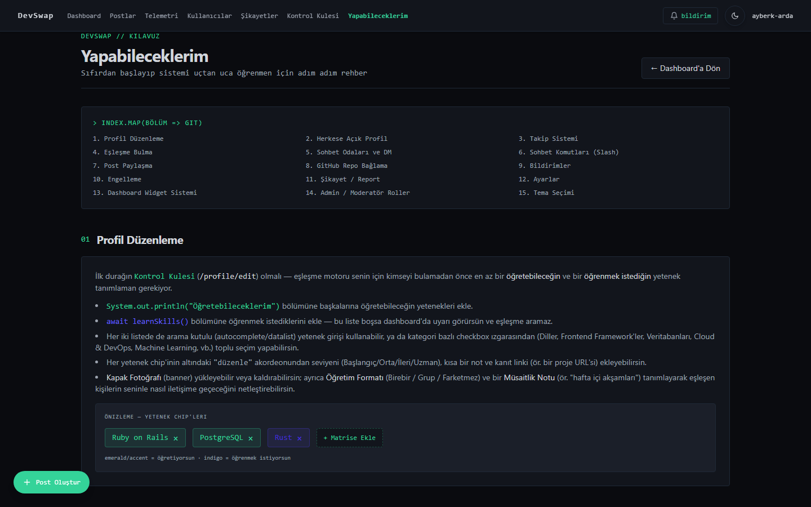
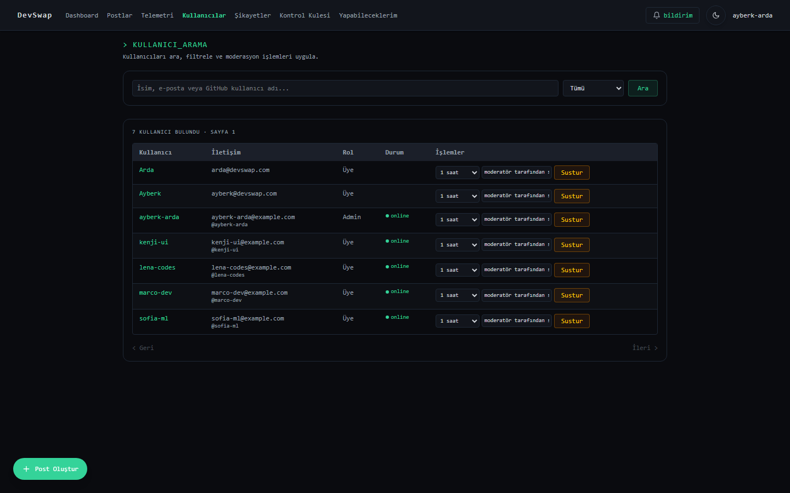
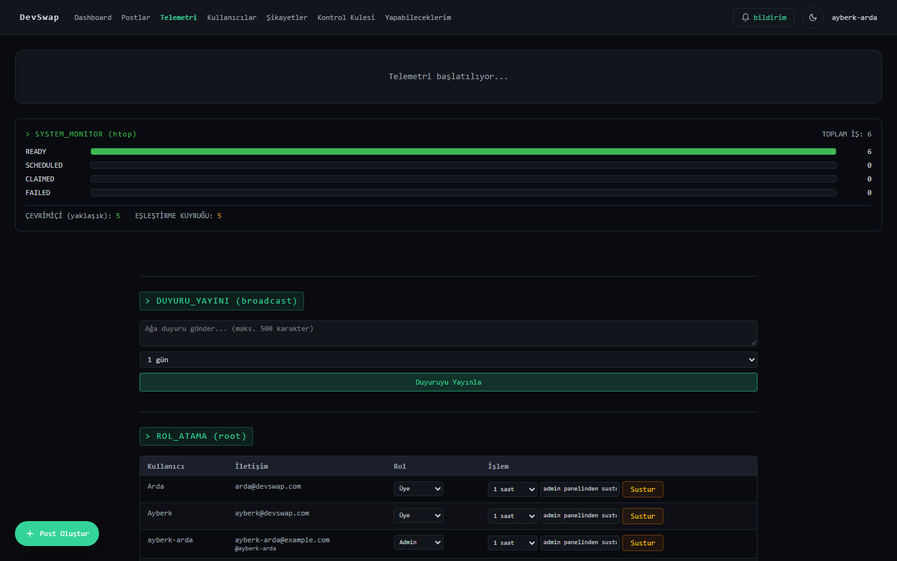

# DevSwap-Teammate

🇬🇧 English | [🇹🇷 Türkçe](README.tr.md)

**Peer-to-peer developer skill exchange, wrapped in a terminal/hacker aesthetic.**

DevSwap matches developers who want to **teach** a skill with developers who want to **learn** it, using GitHub activity and a category-aware pgvector semantic matching engine. Once matched, users get a real-time terminal-style chat with DMs, a public profile, a social feed for sharing progress, and a fully customizable widget-based dashboard — all rendered in a nostalgic green-on-black terminal UI (with ten other themes to pick from).

---

## Screenshots

> Captured with Playwright against a local instance seeded with demo data (dark theme).

| Dashboard | Social feed |
|---|---|
|  |  |

| Public profile | Public chat room |
|---|---|
|  |  |

| Match DM | Notifications |
|---|---|
|  |  |

| Settings | Onboarding guide |
|---|---|
|  |  |

| Admin: users | Telemetry |
|---|---|
|  |  |

---

## Tech Stack

| Layer | Technology |
|---|---|
| Language | Ruby **4.0.5** |
| Framework | Rails **~> 8.1.3** (Propshaft asset pipeline) |
| Database | PostgreSQL with the **pgvector** extension (via the `neighbor` gem) |
| Frontend | Tailwind CSS, Hotwire (**Turbo** + **Stimulus**), importmap-rails |
| Background jobs / cache / websockets | **Solid Queue**, **Solid Cache**, **Solid Cable** (all database-backed — no Redis required) |
| Auth | GitHub OAuth (`omniauth-github`, `omniauth-rails_csrf_protection`) |
| GitHub API | `octokit` (repo scanning) |
| Images | `image_processing` (Active Storage variants — banners, avatars) |
| Deploy | `kamal` + `thruster` (Docker-based deployment, HTTP asset caching/X-Sendfile) |
| Other notable gems | `bcrypt` (has_secure_password), `jbuilder`, `bootsnap`, `tzinfo-data` (Windows/JRuby) |
| Dev/test | `debug`, `brakeman`, `bundler-audit`, `rubocop-rails-omakase`, `web-console`, `capybara`, `selenium-webdriver` |

---

## Core Features

### Matching & Skills
- **Category-aware pgvector matching** (`app/services/match_finder.rb`, `app/services/user_embedding_builder.rb`): each user has separate 512-dimension "teaching" and "learning" embeddings (`UserSkillVector`). The vector splits into two disjoint sub-ranges — 128 dimensions of **category hashing** (so different skills in the same category, e.g. "language", share a baseline similarity) and the remaining 384 dimensions of **skill-identity hashing** (spelling variants of the same skill, resolved through `SkillAlias`, collapse into the same bucket). `MatchFinder` runs an HNSW cosine nearest-neighbor search (via `neighbor`) over a wide candidate pool (200), then applies relational filters (self, blocks), ranks **reciprocal** (two-way teach/learn) matches above one-way matches, applies an optional rating boost, and computes a separate user-facing **match-quality percentage** that blends raw cosine similarity with actual normalized skill-name overlap so a genuine skill intersection is never shown as a misleading 0%.
- **Canonical skill pool** (`db/seeds/canonical_skills.rb`): 303 curated skill names across 9 categories — Languages, Frontend Frameworks & Libraries, Backend Frameworks (incl. Web3/blockchain tooling), Databases & ORMs, Cloud & DevOps, Machine Learning & Data Science, Game Development, OS & System Administration, and Testing & Tools.
- **GitHub repo scanning**: a background job (`github_scan_job`) scans a user's repositories via the GitHub API and auto-populates their "teaching" skills with a confidence weight; each scanned repo has a per-repo visibility toggle for the public profile.
- Skill entries carry a proficiency level, an optional note, and an optional evidence link, editable per-skill in an accordion UI.

### Social Feed
- Global post feed (`/posts`) with optional title + content + tag chips.
- **Likes**, **reposts**, **saves**, **shares** (send a post as a DM without revealing the recipient count to others), and **comments** (with their own likes/reactions).
- Sort by latest / most liked / most reposted, filter by time range (today/week/month/all), and browse by tag (`/etiket/:tag`).
- GitHub-style search syntax (`PostSearchQuery`): `Users:name` (author substring), `tag:react,laravel` (any-of tag match), plus free text — all combinable in one query.
- Per-post moderation menu: report, mark "interested"/"not interested" (soft-hides that author going forward, reversible from Settings), and block.

### Real-time Chat & DMs
- ActionCable-powered terminal-style chat (`TerminalChatChannel`) with public topic rooms and private 1:1 DMs, live presence badges, typing indicator, read receipts, emoji message reactions, and edit/delete (moderators can delete anyone's message).
- **Match-originated DMs** (opened via the dashboard's "Bağlantı Kur" flow) are tagged with a "Match" badge and offer a mutual end-of-conversation ★1–5 rating; **direct DMs** (opened from a profile's "message" button) behave like a normal chat with no rating flow.
- DM tabs are **dismissible per-user** (`DismissedConversation` — hides without deleting; reappears if a new message arrives) and show unread-count badges. A contact-search sidebar lets users find and start new DMs.
- **Slash command engine** (client + server-effectful), full set: `/clear`, `/whoami`, `/ping`, `/omni` (personal status: GitHub linked, skill counts, embedding presence), `/help`, `/rules`, `/report <name>`, `/block <name>`, `/unblock <name>`, plus staff/admin-only server-enforced commands `/mute <name> <duration>`, `/unmute <name>`, `/ban <name> [duration]`, `/unban <name>`.

### Social Graph
- One-directional **Follow** system (no approval needed) with follower/following counts and list pages (`/u/:id/followers`, `/u/:id/following`).
- **Block** system, self-service (no staff role required): blocking hides posts/profile in both directions, prevents new DMs, and excludes the other party from matching.

### Moderation & Admin Tools
- Role-based access: member / moderator / admin, enforced at controller and model level (the founding admin account is protected from having its role revoked).
- **Complaints** (with optional evidence image) against users or posts, with a status lifecycle (Pending / Reviewed / Actioned / Dismissed) trackable from the reporter's own "Şikayetlerim" page.
- **Bans** (`BannedAccount`, temporary or permanent), **mutes** (`Mute`, timed chat silencing), **warnings** (`UserWarning`), and **escalations** (`Escalation`).
- **Admin namespace** (`/admin/...`): user search/index, complaint review (mark reviewed/actioned/dismiss/destroy), and widget-reset endpoints (force-reset a user's dashboard or profile grid to defaults).
- **Admin broadcasts** (`AdminBroadcast`): site-wide announcements pushed live over ActionCable, with an optional `expires_at`; each user can dismiss their own view (`AdminBroadcastDismissal`) without affecting others, and dismissed broadcasts remain in that user's notification history.

### Customization
- **11 themes** — System, Light, Dark, Dracula, Monokai, Nord, Solarized, Gruvbox, One Dark, Tokyo Night, Matrix (`app/javascript/controllers/theme_controller.js`) — persisted in `localStorage`, reactive to OS dark-mode changes when set to "System".
- **Dashboard widgets** (`DashboardWidget`, 11 types: chatbox, match_algorithm, weather, clock, online_users, recent_contacts, notifications, recent_posts, quick_actions, activity_graph, terminal_shortcuts) — a drag/resize Gridstack.js grid, per-widget font scaling and hide/restore, persisted per user, with a confirm-gated "reset to default" action.
- **Profile widgets** (`ProfileWidget`, 5 types: identity, teaching_skills, learning_skills, github_repos, reposts) — the same Gridstack-based customization system applied to each user's public profile page, editable only by the profile owner; visitors see a read-only rendering of the saved layout.

### Notifications
- **Post notifications** (`PostNotification`): created when a new post matches a user's learning skills, surfaced via a bell dropdown (unseen-count badge) and a full `/notifications` history page with per-item "interested"/dismiss actions.
- **Match digests** (`MatchDigest`) power a periodic (weekly) job that emails/surfaces fresh match suggestions.
- **Dismissed conversations** (`DismissedConversation`) let a user hide a DM tab without losing the underlying room.

### Telemetry
- A **separate PostgreSQL database** (`telemetry`, alongside `primary`, `cache`, `queue`, and `cable` — five databases total per environment, configured in `config/database.yml`) holds `TelemetryRecord`/`TelemetrySnapshot` data, isolated from the main app schema (`db/telemetry_structure.sql`).
- **Recurring Solid Queue jobs** (`config/recurring.yml`): `bootstrap_telemetry_tick` (`TelemetryTickJob`, every minute) and `telemetry_partition_maintenance` (`TelemetryPartitionMaintenanceJob`, daily at 3am); production additionally runs `clear_solid_queue_finished_jobs` hourly.
- An admin-facing `/telemetry` dashboard shows queue jobs and online users.

### Other Notable Features
- **PWA support** via `rails/pwa` (`/manifest`, `/service-worker`).
- **In-app onboarding guide** (`/guide`) — a 15-section walkthrough covering profile editing, public profiles, follow, matching, chat/DM, slash commands, posting, GitHub linking, notifications, blocking, complaints, settings, the widget dashboard, admin/moderator roles, and theme selection.
- **Settings page** (`/settings`) consolidates Saved posts, "Not interested" preferences (`FeedPreference`), and Blocked users into one view.
- **Ratings** (`Rating`): mutual ★1–5 end-of-match feedback that feeds the match-ranking boost.
- **Activity logging** (`ActivityLog`) for admin-facing audit trails.

---

## Directory Structure

```
app/
  controllers/        Dashboard, rooms/messages, posts & interactions (likes, reposts,
                       saves, shares, comments), notifications, profiles, GitHub
                       repositories, user skills, moderation (bans/mutes/warnings/
                       escalations/complaints), admin_broadcasts, admin namespace,
                       sessions (GitHub OAuth), guide, telemetry, chat_commands.
  models/              User, ChatRoom/Message/MessageReaction, Post/Comment/
                       CommentReaction, Like/Repost/SavedPost/PostShare,
                       PostNotification/MatchDigest/DismissedConversation,
                       Skill/SkillAlias/UserSkill/UserSkillVector,
                       GithubRepository, DashboardWidget/ProfileWidget,
                       AdminBroadcast/AdminBroadcastDismissal, Rating, Follow/Block,
                       FeedPreference, moderation models (BannedAccount, Mute,
                       UserWarning, Escalation, Complaint), ActivityLog,
                       TelemetryRecord/TelemetrySnapshot.
  services/            Plain-Ruby domain logic: MatchFinder + UserEmbeddingBuilder
                       (pgvector matching), PostSearchQuery (feed search parsing),
                       SkillResolver (alias/canonicalization).
  channels/            TerminalChatChannel, the ActionCable channel behind real-time chat.
  javascript/
    controllers/       Stimulus controllers: theming, dashboard/profile Gridstack
                       grids, chat messages, DM/contact search, notifications,
                       tag picker, infinite scroll, toast, clock/weather widgets.
    channels/           terminal_chat_channel.js — client-side chat + slash commands.
  views/
    dashboard/          Widget-based dashboard shell, room tabs, chat panel, and
                       per-widget partials (app/views/dashboard/widgets/).
    rooms/               Chat room view and DM sidebar (contact search / dismissible tabs).
    guide/               The 15-section onboarding guide.
    pwa/                 PWA manifest and service worker templates.
db/
  seeds/               Seed data, including canonical_skills.rb (the ~300-skill pool).
  telemetry_structure.sql   Schema for the separate telemetry database.
config/
  database.yml         Five-database setup: primary, cache, queue, cable, telemetry.
  recurring.yml        Solid Queue recurring job schedule.
  routes.rb            Full route/feature surface.
```

---

## Installation & Local Setup

### Requirements
- Ruby **4.0.5** (see `.ruby-version`)
- Rails **~> 8.1.3**
- PostgreSQL with the **pgvector** extension available (required by the `neighbor` gem)
- Bundler

### 1. Install dependencies
```bash
git clone <repo-url>
cd dev_swap
bundle install
```

### 2. Configure the database
This app uses **five PostgreSQL databases per environment** — `primary`, `cache`, `queue`, `cable`, and `telemetry` (see `config/database.yml`). Adjust credentials there if needed, then:

```bash
bin/rails db:create db:schema:load
bin/rails db:seed
```

`db:seed` loads the canonical skill pool (`db/seeds/canonical_skills.rb`) along with other seed data.

### 3. Run the app
```bash
bin/dev
```

For background jobs (Solid Queue), on Linux/macOS/production use `bin/jobs`. On native Windows, `bin/jobs`'s Supervisor relies on `Process.fork`/`SIGQUIT`, which aren't supported — use the Windows-only dev worker instead:

```bash
bin/dev_worker
```

---

## Testing

The project has a substantial test suite under `test/` covering models, controllers, jobs, services, channels (including `terminal_chat_channel`), and system flows (dashboard grid/DM dock behavior, chat UI, post feed, profile grid, theme dropdown, and more). As of this writing: **612 unit/model/controller/job/service/channel tests** (2,085 assertions) and **21 Capybara/Selenium system tests** (174 assertions), all passing.

```bash
bin/rails test          # unit/integration tests
bin/rails test:system   # Capybara/Selenium system tests
bin/rubocop              # style lint (rubocop-rails-omakase config in .rubocop.yml)
bin/brakeman             # static security analysis
bin/bundler-audit        # dependency vulnerability scan
```

CI (`.github/workflows/ci.yml`) runs Brakeman, bundler-audit, `bin/importmap audit`, RuboCop, the test suite, and the system-test suite (against a `pgvector/pgvector` Postgres service container) on every push/PR to `main`/`master`.

---

👨‍💻 Developer: **Ayberk Arda**

Software Developer | Computer Programming, Istanbul Kültür University (İKÜ)
